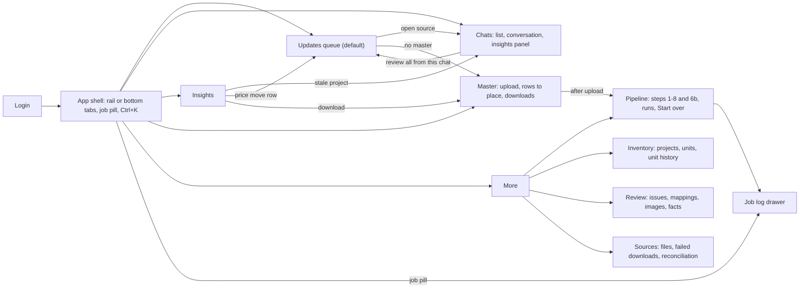
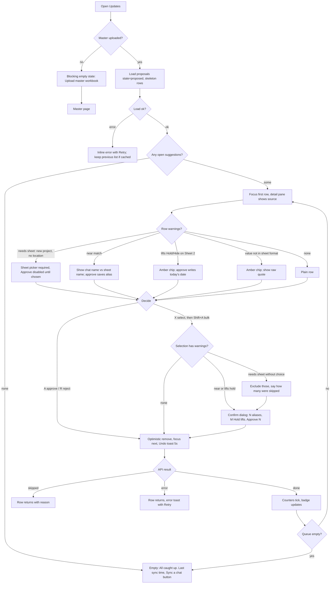
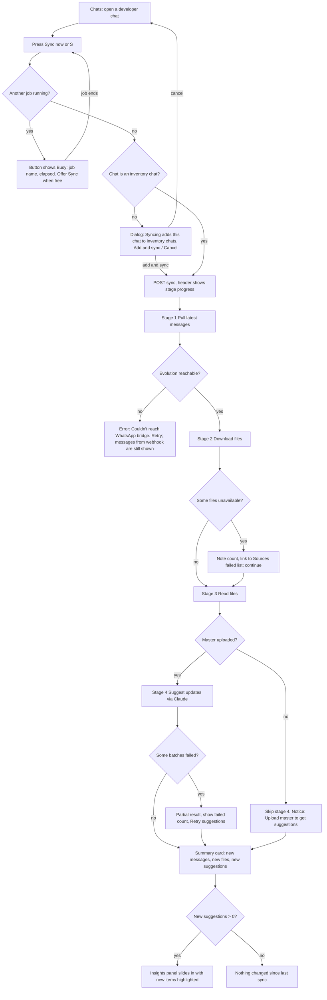
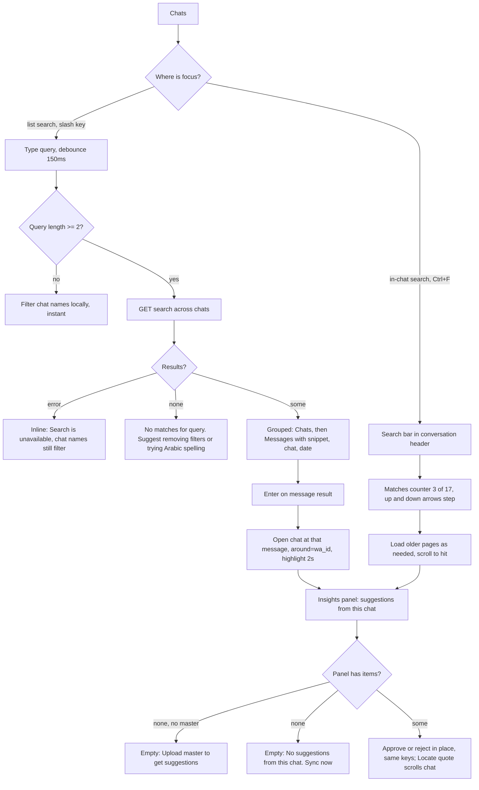
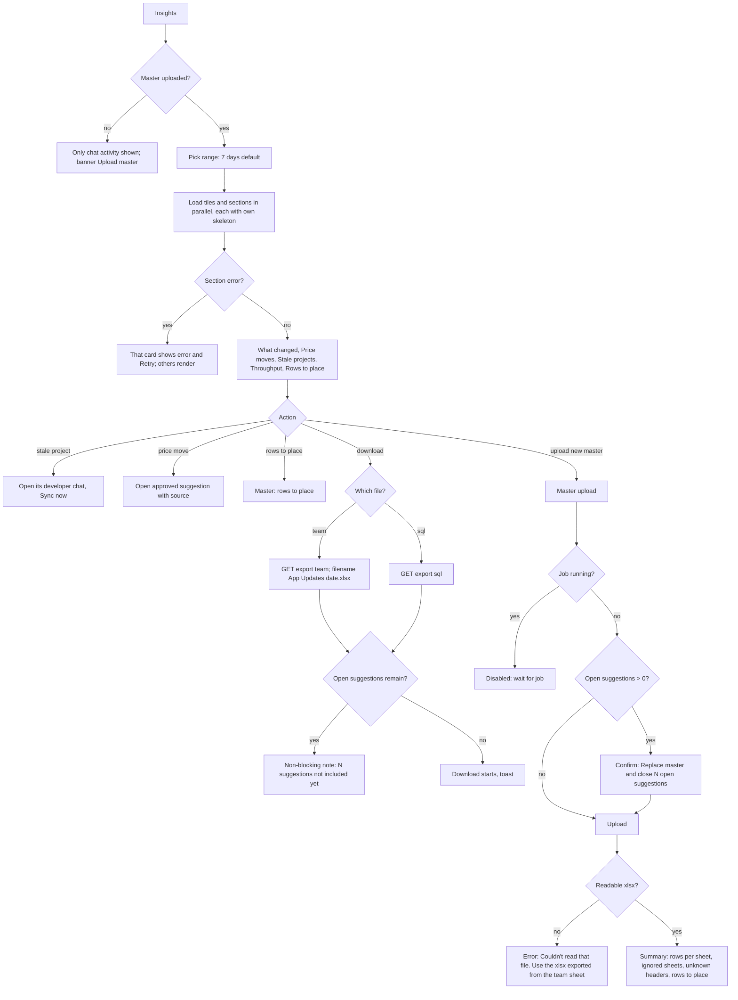

# Receiver admin app: UX revamp spec

Status: design spec for the React + Framer Motion SPA rebuild. No code changes implied beyond the API section.
Grounded in `receiver/web.py`, `feed.py`, `master.py`, `proposals.py`, `history.py`, `jobs.py`, `db.py` as of 2026-11.

**Users:** the Byit admin and ops team. They are not technical and spend their day in WhatsApp. They work on desktop first, but every screen must work at a 390px phone width.
**Daily jobs, in priority order:** (1) approve sheet updates, (2) sync one developer chat, (3) search chats, (4) insights and exports.
**Out of scope:** sending anything to WhatsApp and changing extraction logic. The app stays listen-only.

---

## 0. Design principles

1. **The queue is home.** The app opens on Updates. Every other screen exists to feed it or explain it.
2. **Source is always one click away.** Every value shows where it came from (message, file row or PDF page) and links to that chat.
3. **Keyboard first, tap safe.** Every daily action has a single-key shortcut on desktop. On a phone, every action has a 44px target and no action depends on hover.
4. **Plain words.** Say "suggestion" rather than "proposal" in the UI, "chat" rather than "group/jid", and "sheet row" rather than "master_row". Field keys use `UNIT_LABELS` and the `label` filter, for example `apartment_2` becomes "Apartment 2".
5. **No pipeline literacy required.** Steps 1 to 8 move under More > Pipeline. Daily users only see "Sync now" on a chat.
6. **Arabic-aware.** Message text, quotes and project names use `dir="auto"`. Search must match Arabic, English and Franco-Arabic text.

---

## 1. Information architecture

### 1.1 Final navigation

| Slot | Label | Route | Replaces / absorbs | Badge |
|---|---|---|---|---|
| Primary 1 (default) | **Updates** | `/updates` | `/updates` | open suggestions (`proposals.state='proposed'`) |
| Primary 2 | **Chats** | `/chats/:jid?` | `/feed`, `/groups`, `/groups/{jid}`, `/sources/message/{wa_id}` | chats with open suggestions |
| Primary 3 | **Insights** | `/insights` | dashboard counts, Master stat tiles | none |
| Primary 4 | **Master** | `/master` | `/master` (upload, rows to place, downloads) | open rows to place (`master_issues.state='open'`) |
| More | **Pipeline** | `/more/pipeline` | `/` (dashboard steps, recent runs, Start over), `/jobs/{id}` | spinner while a job runs |
| More | **Inventory** | `/more/inventory` | `/projects`, `/projects/{slug}`, `/units`, `/units/{id}` | none |
| More | **Review** | `/more/review` | `/review`, `/review/mappings`, `/review/context`, `/review/images`, `/review/fact/{id}` (as tabs) | `open_issues` (high/medium) |
| More | **Sources** | `/more/sources` | `/sources`, `/sources/row/{id}`, `/reconciliation` (as a tab) | failed downloads |
| More | Log out | `/logout` | | |

Decisions:
- **Feed and Groups merge into Chats.** The chat list replaces the Groups table. The "inventory chat" tick becomes a toggle in the chat header and a filter chip in the list, so there is no bulk form page any more. A bulk mode remains: in list multi-select, pressing `Space` toggles scope.
- **Projects and Units merge into Inventory.** It has a project list, then project detail with a units tab, and unit history opens in a drawer. This area belongs to the legacy inventory and is not on the master-workbook path, so it is demoted.
- **Review, Mappings, Images and Facts become tabs of one Review page.** They matter only to whoever runs the full pipeline.
- **Reconciliation becomes a tab of Sources.** It is an audit view, not a daily one.
- **Pipeline is demoted, not deleted.** The full run, re-runs with `redo` and Start over stay there. A global **job pill** in the top bar shows any running job from any screen.
- Every legacy URL gets a client-side redirect to its new home, so bookmarks keep working.

### 1.2 App shell

- **Desktop (≥1024px):** a 56px icon rail on the left with labels shown in tooltips. A 48px top bar holds the page title, the global search trigger (`Ctrl/⌘K`), the job pill, and market (`market.short`) plus a theme toggle.
- **Tablet (640–1023px):** the rail stays. Three-pane screens collapse to two panes, and the third opens as a slide-over.
- **Phone (<640px):** a bottom tab bar holds Updates, Chats, Insights, Master and More, each with an icon and label (5 × 78px). The top bar keeps the title and job pill. Panes stack and push like WhatsApp mobile: list, then detail, then insights sheet.
- **Command palette (`Ctrl/⌘K`):** jump to a chat or project, plus actions such as "Sync <chat>", "Download team file", "Upload master" and "Go to rows to place". It uses the same search endpoint as Chats.

### 1.3 Global navigation map

---

## 2. Flows per daily job

### 2.1 Job 1: Approve sheet updates fast

### 2.2 Job 2: Sync one developer chat on demand

### 2.3 Job 3: Search chats (WhatsApp Web style)

### 2.4 Job 4: Insights and exports

---

## 3. Screen specs

Conventions: **D** = desktop, **P** = phone (390px). "Source" means `/api/...` (see §4) followed by the DB fields behind it.

### 3.1 Updates (default route)

**Purpose:** work the suggestion queue to zero as fast as safely possible.

**Layout D:** filter bar (full width), then queue list (60%) beside a detail pane (40%, sticky). A bulk bar slides up from the bottom of the list when at least one row is selected.
**Layout P:** filter chips scroll horizontally above a card list. Tapping a card opens a full-screen detail with sticky Approve/Reject at the bottom. Swipe right approves and swipe left rejects. Swipe is disabled on rows with blocking warnings, and both swipe actions also have explicit buttons.

**Filter bar:**
- State segmented control: Open / Approved / Rejected / Superseded, each with a count from `proposals.state` counts.
- Sheet select (`master_schema.SHEETS`).
- Match select: exact / alias / near / new.
- Warning chips: Near match · Lifts Hold/Hide · Needs sheet · Format check · New project.
- Source chat select (new).
- Text search over project, developer and matched_label.
- Sort: By project (default, matches the current `ORDER BY project_key, field`) · Newest source · Warnings first.

**Queue row (D, 40px default, 56px with warnings):**
- Checkbox.
- Project: `row_project or project`, with developer below in muted text.
- Sheet · row: `sheet`, `row_number`, or a "New" tag.
- Column: the field label.
- **Old → New**: `old_raw` in strikethrough-muted text, an arrow, then `new_raw` in semibold. For unit fields, show parsed deltas such as "+6.2%" and "area 125→130" from `new_parsed_json` compared with `ms.parse(old_raw)`.
- Source chip: an icon for message / file row / PDF page, the chat name and a relative time (`source_ts`).
- Warning chips.
- Rows are grouped under sticky project headers ("Jiran · New Cairo · 4 suggestions") with a group-level "Approve 4" action.

**Detail pane:**
- The full quote (`quote`, `dir=auto`, matched text highlighted).
- Source preview. For `source_kind='message'`, the message plus ±30 minutes of neighbours, the same data as `/sources/message`. For `row`, the row cells with the header row aligned, the same data as `/sources/row`. For `pdf_page`, the page text excerpt and an "Open PDF" link.
- Current sheet row: all current values (`master.row_values`) with the target cell outlined, so the admin sees context such as the payment plan next to the price.
- History of this cell: earlier approved, rejected and superseded suggestions for the same `row_id + field`.
- Actions: Approve, Reject, Open in chat, and a Sheet picker (only for `match_state='new'` with an empty `sheet`).

**Warning rendering** (parse `warning`, which is `;`-joined, into codes; §4 adds structured codes):

| Code | Trigger in `master.add_proposal` | Treatment |
|---|---|---|
| `near_match` | `match_state='near'` | Amber chip "Near match". Detail shows "Chat: Jirian → Sheet: Jiran", and approving "saves Jirian as a name for Jiran". |
| `lifts_hold` | Sheet 2 row with Hold/Hide date | Amber chip "Lifts Hold/Hide". Approve tooltip says "Writes today's date and removes Hold". |
| `needs_sheet` | new project, no location | Red chip "Choose sheet". **Blocks** approve until a sheet is picked. |
| `bad_format` | parsed not ok | Amber chip "Check format". The raw value is shown monospace. |
| `new_project` | `match_state='new'` (with sheet) | Info chip "New row on <sheet>". |

**Keyboard (Updates and the Chats insights panel):**

| Key | Action |
|---|---|
| `j` / `k` or ↓ / ↑ | next / previous row |
| `a` | approve focused row |
| `r` | reject focused row |
| `x` | toggle select; `Shift+x` selects a range from the last selected |
| `Shift+A` / `Shift+R` | approve / reject selected |
| `g` | select all in the focused project group |
| `s` | open sheet picker (needs-sheet rows), then `1`–`5` to choose |
| `o` | open source in Chats (new tab with `Ctrl`) |
| `Space` | expand/collapse quote on phone-width layouts; on desktop, scroll the detail pane |
| `u` or `Ctrl+Z` | undo last decision (within 5 s) |
| `/` | focus search · `f` focus filters · `1`–`4` switch state tab |
| `?` | shortcut sheet |

**Undo:** decisions commit **after a 5 s grace window**, or immediately when the user leaves the screen, when another decision batch starts, or on `pagehide` via `sendBeacon`. The backend has no un-approve today (see owner decisions).

**States:**
- Loading: 8 skeleton rows, shown only if loading takes more than 300 ms.
- Empty (open): "All caught up", with the last sync time and buttons "Sync a chat" and "See this week's changes".
- Filtered-zero: "No suggestions match these filters" with a "Clear filters" button.
- No master: a blocking card titled "Upload the App Updates workbook to start" with a button to Master.
- Error: inline banner "Couldn't load suggestions. Retry"; the cached list stays visible.
- Partial skip: "2 skipped: choose a sheet for new projects"; skipped rows stay with a red outline.
- Job running (step 6b): a non-blocking info bar "New suggestions are being added" and a "Refresh (+N)" pill that never reorders the list under the user.

### 3.2 Chats

**Purpose:** a WhatsApp-Web-style reading view of every chat, with instant search, single-chat sync, and that chat's suggestions beside it.

**Layout D:** chat list (320px) | conversation (flex) | insights panel (360px, collapsible with `i`).
**Layout P:** chat list, then conversation (push), then insights as a bottom sheet (snap 50% / 92%) opened from a header chip "5 suggestions".

**Chat list:**
- Search box (`/`).
- Filter chips: All · Inventory chats (`in_scope`) · Has suggestions · Groups · Private.
- Rows show an initials avatar, the name, the last preview (`feed.channels` preview, `last_ts`), and badges for open suggestions (accent), media count, and an inventory dot.
- Sorted by `last_ts` desc.
- Multi-select mode is reached via `Shift+click` or long-press on a phone. In that mode, `Space` toggles inventory scope, which replaces the Groups form.

**Conversation:**
- Header: name, chat kind, Inventory toggle (`group_scope.in_scope`), "Synced 12 min ago" (new: last sync job for this jid), the **Sync now** button (`S`), and in-chat search (`Ctrl+F`).
- Body: the message stream from `feed.messages` with `before` paging upward. Bubbles show sender name and time. Files appear as cards (workbook, CSV, PDF, image) that open the built-in viewer (`feed.preview`: sheet tabs and exact cells). Attachments in "pending" state lazy-fetch on view (`POST /api/media/{wa_id}`). Messages with "failed" media show "No longer on WhatsApp".
- Messages that produced a suggestion get a small margin marker. Clicking it highlights the matching card in the insights panel, and clicking a card's "Locate" scrolls to the message.
- There is no composer. A footer reads "Read-only. Byit listens to this chat and never posts."

**Sync progress (in header):**
- Four-stage stepper: Messages · Files · Reading · Suggestions.
- Live counts from job progress.
- The result lands as a summary card pinned at the bottom of the conversation: "+18 messages · 2 files (1 unavailable) · 4 new suggestions", followed by "Review 4".

**Insights panel ("Suggestions from this chat"):**
- Tabs: Open (default) · Approved recently · All.
- Cards use the same anatomy as the Updates row, stacked vertically: project, column, old → new, quote, warnings.
- Actions are Approve, Reject and Locate. Keys are the same as Updates once the panel has focus (`Tab` moves focus between panes, or `]` / `[`).
- Footer link: "Open all N in Updates" (Updates filtered by this chat).

**Search:**
- Global results are grouped as Chats, then Messages, showing up to 5 chats and 50 messages with a "More" option.
- Each message result shows a snippet with the hit highlighted, the chat and the date.
- `Enter` opens the chat at the message (`around`).
- In-chat search shows a "3 of 17" counter, `Enter`/`Shift+Enter` to step, and `Esc` to close.

**Keys:** `/` search · `↑/↓` in list · `Enter` open · `Esc` back (phone) / clear search · `S` sync · `i` toggle insights · `Ctrl+F` in-chat search · `Alt+↑/↓` previous/next chat.

**States:**
- No chats: "No chats yet. Run Sync chats in More > Pipeline". This is the only place the pipeline is surfaced.
- No chat selected (D): a quiet placeholder "Pick a chat" with the 3 chats that have the most open suggestions.
- Loading: list skeleton and conversation skeleton bubbles, shown after 300 ms.
- Search error: names still filter locally, and a muted line says "Message search unavailable".
- Sync blocked: the button is disabled with the tooltip "Pipeline step '6. Extract facts' is running (4 min)", plus a "Sync when free" option.
- Evolution error: "Couldn't reach the WhatsApp bridge. Messages that arrived live are still here." with a Retry button.

### 3.3 Insights

**Purpose:** answer "what changed, what moved, what is going stale" and get the files out.

**Layout D:** a range picker (7d / 30d / custom) with export buttons on the right, then a KPI tile row, then a two-column card grid.
**Layout P:** a single column. Tiles sit in a 2×3 grid, and tables become stacked lists.

| Section | Content | Source |
|---|---|---|
| KPI tiles | Open suggestions · Approved in range · Rejected in range · Median time to decision · Rows to place · Stale projects | `proposals` (`state`, `created_at`, `decided_at`), `master_issues.state='open'` |
| What changed | Approved suggestions in range, grouped by project, then field old→new with date and source chat | `proposals WHERE state='approved' AND decided_at in range` |
| Price moves | Table: project · unit type · old (area/price) · new · Δ% · date. Filter by sheet and unit type. Sort by abs Δ%. Status changes (so/Hold/rtm) appear as tags | approved `proposals` on `UNIT_FIELDS`; old parsed via `ms.parse(field, old_raw)`, new from `new_parsed_json.price_egp` |
| Stale projects | Sheet rows with no approval and no master `date` within N days (N = 14/30/60 selector). Columns: project · developer · sheet · last update · source chat. Action: "Open chat" | `master_rows` (state in `USABLE`), `master.approval_date`, `master_cells field='date'` |
| Throughput | Bars per day: suggested vs decided, with an open-backlog line | `proposals.created_at`, `decided_at` |
| Chat activity | Top chats by new messages in range, their open suggestions, last sync | `source_messages`, `jobs` |
| Rows to place | Count plus the first 5, linking to Master | `master_issues` |

Charts are small, use no 3D or gradients, and offer a data table toggle for accessibility. Each card loads independently with its own skeleton and error/Retry state. Empty range: "No approvals in this period".

### 3.4 Master

**Purpose:** manage the source-of-truth workbook. It handles upload and replace, rows to place, and the two downloads.

**Layout D:**
- Current-master card: `master_imports.file_name`, `imported_at`, rows per sheet (`summary_json.sheets`), ignored sheets, unknown headers, and the legacy-duplicate count.
- Downloads card: **Team file** and **SQL-ready file**, each with a one-line description taken from the current copy.
- Upload card: a dropzone that accepts `.xlsx` only.
- Rows to place table.

**Layout P:** the same cards stacked, with Rows to place as cards.

**Rows to place:**
- Open/All toggle.
- Columns: sheet·row, developer, project, location, reason (from `master_issues` join `master_rows`).
- Actions: **Move to [sheet ▾]**, **Keep here**, **Drop**. Move is pre-selected to `target_sheet` when one is set.
- Keys: `j/k`, `m` move, `h` keep here, `d` drop. A Drop needs no extra confirm, but it does get an Undo toast because it is reversible by Keep.

**Upload states:**
- Job running: the dropzone is disabled with the reason given.
- Open suggestions exist: a named confirm reading "Replace master and close 42 open suggestions" (`proposals` will become `superseded`).
- Success: a summary diff showing new versus previous row counts per sheet, with a prompt to "Sync chats to compare with this file".
- Error: "Couldn't read that file. Upload the .xlsx exported from the team sheet."
- Empty (no master): this page is the onboarding page. A single dropzone shows the list of sheets read.

### 3.5 More > Pipeline

This holds the current dashboard content, re-skinned:
- Counts tiles (`groups`, `in_scope`, `messages`, `files`, `projects`, `units`).
- `STEPS` as a vertical list with Run and the `redo` checkbox where it applies today.
- Recent runs (`jobs` last 8).
- Start over, behind a typed `DELETE ALL` confirm.

The job log opens in a right drawer (D) or full screen (P), with lines streaming via polling. One new shortcut sits at the top: **"Run chat steps for all inventory chats"** (1, 2, 3, then 6b in sequence). That is exactly today's sync routine, as one job.

### 3.6 More > Inventory, Review, Sources

These are ports of the existing pages using the new components (data table, drawer, tabs). The data and actions are unchanged:
- **Inventory:** the project list (`/projects` query plus search) and project detail. Detail tabs are Key facts (`fact_summary`, with Conflict/Not supplied), Phases, Units (`latest_snapshots`) and Images (approved `media_assignments`). Unit history opens in a drawer (`unit_snapshots` joined to `source_rows`).
- **Review:** tabs are Issues (`review_issues` by type and severity), Mappings (`label_contexts` + `label_mappings`, with approve/edit/exclude/reject and a context drawer with sample rows and a layout editor), Images (`media_assignments`: approve/withhold/exclude) and Facts (status set).
- **Sources:** tabs are Files (`source_files` with posts and rows), Failed downloads (`media_fetch.status='failed'`, with "Retry in chat") and Reconciliation (`build.reconcile`, shown as a checklist with green "adds up" or red).

Keyboard: standard table navigation (`j/k`, `Enter` opens the drawer, `Esc` closes it).

### 3.7 Login

A single password field labelled "Team password", with the button "Log in". On error: "That password didn't work. Check with the owner." Sessions last 14 days, as today.

---

## 4. JSON API for the SPA

All endpoints live under `/api`. The cookie session is unchanged. **Change:** for `/api/*`, the auth middleware returns `401 {"error":"login"}` instead of a 303 redirect. Errors share one shape: `{error: string, detail?: any}`, and HTTP 409 means "another job is running": `{error:"busy", job:{id,name,started_at}}`.

Legend: **[E]** wraps an existing function or query as-is · **[X]** existing plus a small extension · **[N]** needs new backend logic.

### 4.1 Session and shell

| Method | Path | Params | Response sketch | Maps to |
|---|---|---|---|---|
| POST | `/api/login` | `{password}` | `{ok}` + cookie | `web.login` **[E]** |
| POST | `/api/logout` | | `{ok}` | `web.logout` **[E]** |
| GET | `/api/status` | | `{market:{name,short,currency,metric}, has_master, job:{id,name,status,started_at}\|null, counts:{open_suggestions, open_issues, rows_to_place, chats_with_suggestions}}` | `web.page` ctx + counts **[X]** |

### 4.2 Suggestions (Updates)

| Method | Path | Params | Response sketch | Maps to |
|---|---|---|---|---|
| GET | `/api/proposals` | `state, sheet, match, q, chat, warning, sort, cursor, limit≤200` | `{items:[{id,sheet,row_id,row_number,project,row_project,developer,field,field_label,old_raw,new_raw,new_parsed,delta:{price_pct,area_from,area_to}?,quote,source:{kind,ref,ts,chat_jid,chat_name},match_state,matched_label,warnings:[{code,text}],state,decided_at}], counts:{proposed,approved,rejected,superseded}, next_cursor}` | `web.updates` **[X]**: adds the `chat` filter, structured `warnings`, cursor paging (today it is capped at 500), source chat and delta |
| POST | `/api/proposals/decide` | `{ids:[int], action:"approve"\|"reject", sheet_by_id?:{id:sheet}}` | `{done:[id], skipped:[{id,reason}], counts}` | `master.decide` **[X]**: per-id sheet (today there is one `sheet` for all) and returning ids rather than counts |
| GET | `/api/proposals/{id}` | | the item plus `{row_values:{field:raw}, cell_history:[...], source_context}` | `master.row_values`, `web.source_message` / `source_row` **[X]** |

Source chat resolution **[N]**:
- For `source_kind='message'`, `source_ref` is the `wa_id`, which gives `source_messages.group_jid`.
- For `row`/`pdf_page`, `source_ref` is the `source_rows.id`, which leads to `file_id`, then `file_occurrences.wa_id`, then `source_messages.group_jid`.
- A file can come from several chats, so return a list and use the latest as the primary.
- Recommend a stored `proposals.chat_jid` column filled in at `add_proposal` time, plus a backfill.

Structured warnings **[N, small]**: emit `warning_codes` beside `warning` in `add_proposal`. The API can parse the existing strings until that is done.

### 4.3 Chats, messages, files, search

| Method | Path | Params | Response sketch | Maps to |
|---|---|---|---|---|
| GET | `/api/chats` | `scope=all\|ticked, has_suggestions` | `[{jid,name,kind,in_scope,count,media,last_ts,preview,media_preview,open_suggestions,last_sync_at}]` | `feed.channels` **[X]**: adds `open_suggestions` (needs chat_jid) and `last_sync_at` |
| PATCH | `/api/chats/{jid}` | `{in_scope:bool}` | `{jid,in_scope}` | the per-chat form of `web.save_groups` **[X]** |
| PATCH | `/api/chats` | `{jids:[...], in_scope}` | `{updated}` | bulk scope **[X]** |
| GET | `/api/chats/{jid}/messages` | `before, around, q, kind, limit` | `{messages:[{id,ts,sender,text,kind,file_name,mimetype,file,media, suggestion_ids:[...]}], has_more, has_newer}` | `feed.messages` **[X]**: `around=wa_id` for jump-to-result, plus `suggestion_ids` markers |
| GET | `/api/chats/{jid}/proposals` | `state, limit` | same item shape as `/api/proposals` | **[N]** (filter by chat_jid) |
| POST | `/api/chats/{jid}/sync` | `{add_to_scope?:bool}` | `202 {job_id}` · `409 busy` · `422 {error:"not_in_scope"}` | **[N]** `history.sync_chat(log, jid)`, described below |
| POST | `/api/media/{wa_id}` | | `{file}` or `422 {error}` | `feed.fetch_media` **[E]** |
| GET | `/api/files/{id}/preview` | | `{type:"sheets",sheets:[...]}\|{type:"pdf",pages}` | `feed.preview` **[E]** |
| GET | `/api/files/{id}` | `download` | file bytes | `web.source_file` **[E]** |
| GET | `/api/search` | `q (≥2), jid?, limit` | `{chats:[{jid,name,hits}], messages:[{jid,chat_name,wa_id,ts,sender,snippet,match_ranges}]}` | **[N]**, described below |

**`sync_chat` [N]** runs one job and logs stages so the UI can show the stepper:
1. **Pull latest** with `evolution.find_messages(jid, page)`, starting at page 1 and stopping once a page stores 0 new rows. This catches up anything the webhook missed. Today's `pull_history` walks every page of every ticked chat.
2. **Download** works like `download_media` restricted to `group_jid=jid`.
3. **Read files** works like `parse_files.parse_all` restricted to files whose `file_occurrences` belong to the jid.
4. **Suggest** runs `proposals.from_messages` and `from_files` restricted to the jid. Skip with a logged notice when `master.current_import` is None.

The job must hold the same `jobs._lock`. On finish it should emit a summary line in JSON, for example `RESULT {"messages":18,"files":2,"files_failed":1,"suggestions":4}`.

**Search [N]:** today's search is `LIKE` on one chat only (`feed.messages q`, `web.group_messages q`). Add an SQLite **FTS5** table over `source_messages(text, file_name, sender_name)` with `unicode61 remove_diacritics 2`, kept in sync by triggers. Apply Arabic normalisation at index and query time: unify أ/إ/آ to ا, ى to ي, ة to ه, and strip tatweel and harakat. Results should be ranked and snippeted with `snippet()`. The target is p95 under 150 ms at 500k messages. Local chat-name filtering is client-side.

### 4.4 Jobs

| Method | Path | Params | Response sketch | Maps to |
|---|---|---|---|---|
| GET | `/api/jobs` | `limit=8` | `[{id,name,status,started_at,finished_at}]` | dashboard `recent` **[E]** |
| POST | `/api/jobs/{name}` | `{redo?}` | `202 {job_id}` · `409 busy` | `web.start_job` **[E]** |
| GET | `/api/jobs/{id}` | `since` (byte offset) | `{id,name,status,started_at,finished_at,log_chunk,next_offset, progress:{stage,done,total}?, result?}` | `jobs` table **[X]**: log offset tailing. `progress` and `result` are **[N]**, parsed from `PROGRESS`/`RESULT` log lines so `jobs.py` keeps its schema. |

Polling: every 1 s while the job is `running` and the tab is visible, every 5 s when hidden, and stop when the job reaches `done`/`failed`/`interrupted`. `/api/status` is polled every 15 s for the job pill and badges, the same cadence as the feed refresh today.

### 4.5 Master and exports

| Method | Path | Params | Response sketch | Maps to |
|---|---|---|---|---|
| GET | `/api/master` | | `{import:{file_name,imported_at}\|null, summary, counts:{proposed,approved}, grid_sheets}` | `web.master_page` **[E]** |
| POST | `/api/master` | multipart `file` | `{summary, superseded:int}` · `409 busy` · `422 {error}` | `master.import_workbook` **[X]**: also returns the superseded count |
| GET | `/api/master/issues` | `show=open\|all` | `[{id,issue_type,reason,state,sheet,row_number,developer,project,location_code,target_sheet}]` | `web.master_page` query **[E]** |
| POST | `/api/master/issues/{id}` | `{action:"move"\|"keep"\|"drop", sheet?}` | `{id,state}` | `master.resolve_issue` **[E]** |
| GET | `/api/master/export/{team\|sql}` | | xlsx bytes, `Content-Disposition` | `master_export.team_file` / `sql_file` **[E]** |

### 4.6 Insights [all N]

The SQL aggregates sit over existing tables. No schema change is needed beyond `proposals.chat_jid`.

| Method | Path | Params | Response sketch |
|---|---|---|---|
| GET | `/api/insights/summary` | `from,to` | `{open, approved, rejected, median_decision_s, rows_to_place, stale_count}` |
| GET | `/api/insights/changes` | `from,to,sheet?` | `[{project,developer,sheet,items:[{field,old_raw,new_raw,decided_at,source}]}]` |
| GET | `/api/insights/price-moves` | `from,to,sheet?,field?` | `[{project,sheet,field,old:{area,price,status},new:{...},pct,decided_at,proposal_id}]` (parse via `master_schema.parse`) |
| GET | `/api/insights/stale` | `days=14,sheet?` | `[{row_id,project,developer,sheet,last_update,basis:"approval"\|"master_date"\|"never",chat_jid?}]` (via `master.approval_date` + `master_cells.date`) |
| GET | `/api/insights/throughput` | `from,to,bucket=day` | `[{day,suggested,approved,rejected,open_end}]` |
| GET | `/api/insights/chats` | `from,to` | `[{jid,name,messages,suggestions,last_sync_at}]` |

### 4.7 Legacy (More) — straight JSON ports **[E]**

- `GET /api/projects?q` · `GET /api/projects/{slug}` (`web.project` ctx) · `GET /api/units?q,status,max_price` · `GET /api/units/{id}`
- `POST /api/facts/{id}` `{status}`
- `GET /api/review/issues?kind` · `GET/POST /api/review/mappings` · `GET /api/review/context?key` · `POST /api/layout`
- `GET/POST /api/review/images`
- `GET /api/sources` · `GET /api/sources/messages/{wa_id}` · `GET /api/sources/rows/{id}` · `GET /api/reconciliation`
- `POST /api/reset` `{confirm:"DELETE ALL"}`

Endpoints needing new backend logic:
1. `sync_chat` (single-chat pull, download, read and suggest).
2. Proposals' `chat_jid`, per-chat proposals and suggestion markers.
3. FTS5 search with Arabic normalisation and `around` paging.
4. Insights aggregates.
5. Job progress and result lines with log offset tailing.
6. `decide` with per-id sheet and returned ids.
7. Structured warning codes.
8. A JSON 401 in the auth middleware.

---

## 5. Motion guidelines (Framer Motion)

**Tokens**

| Token | Value | Use |
|---|---|---|
| `dur.instant` | 0 ms | filter changes, search results, sorting |
| `dur.fast` | 120 ms | hover/press, counters, chips, route fade |
| `dur.base` | 180 ms | row exit/collapse, toasts, popovers |
| `dur.slow` | 240 ms | side panels, drawers, bottom sheets |
| `ease.standard` | `[0.2, 0, 0, 1]` | enter and move |
| `ease.exit` | `[0.4, 0, 1, 1]` | leave |
| `spring.sheet` | `{type:"spring", stiffness:500, damping:40}` | phone bottom sheet drag release only |

Wrap the app in `<MotionConfig reducedMotion="user" transition={{duration:0.18, ease:[0.2,0,0,1]}}>`.

**What animates**
- **Approve/reject row exit:** the row fades to 0 and shifts `x: +12` on approve or `x: -12` on reject over 180 ms. Then its height collapses over 180 ms (`AnimatePresence` + `layout` on siblings). **Focus moves to the next row immediately**, and keys are never blocked while an exit plays. A bulk exit of more than 10 rows uses a single fade of the whole selection with no per-row offset.
- **Undo:** the row re-enters with opacity 0 to 1 and height from 0 at 180 ms, at its original index.
- **Queue counters and badges:** cross-fade the number at 120 ms. There is no rolling digit or bounce. Use `tabular-nums`, so width never shifts.
- **Insights panel / drawers:** `x: 24 → 0` plus opacity, 240 ms. Exit runs at 180 ms with `ease.exit`. Drawers do not move content underneath; the main area resizes without animation on desktop.
- **Phone bottom sheet:** `y: 100% → snap`, using `spring.sheet` for drag release and 240 ms tween otherwise.
- **Route transitions:** opacity 0 to 1 at 120 ms on the new page only, with no slide and no exit wait (`mode="popLayout"`). Phone push/pop between chat list and conversation uses `x: 100% → 0` at 240 ms, matching platform convention.
- **Sync stepper:** the active stage's dot pulses opacity 0.5 to 1 at 1.2 s, and completed stages switch instantly to a check.
- **Jump-to-message highlight:** the background fades from accent-subtle to transparent over 2 s.
- **Toasts:** `y: 8 → 0` plus opacity at 180 ms, stacking a maximum of 3.

**What must not animate**
- Table and list re-renders from filtering, sorting, search typing or polling refresh. New items arriving from polling never shift rows under the cursor; show the "Refresh (+N)" pill instead.
- Message stream scroll and infinite-load prepends, which must keep scroll position.
- Skeletons get a static tint, with no shimmer sweep.
- Job log lines.
- Charts render without entrance animation.
- No layout animation on any element the user is about to click. Nothing over 300 ms except the 2 s highlight fade, and no parallax, bounce, scale-pop or confetti.

**prefers-reduced-motion**
- All `x`, `y`, scale and height transforms become instant (duration 0).
- Opacity fades are kept at 120 ms or less because they aid continuity.
- The row exit becomes an instant removal followed by a 120 ms fade-in of the "Approved · Undo" toast.
- The stepper pulse becomes a static filled dot.
- The highlight fade becomes a static outline for 2 s.
- Bottom sheets appear without slide.

---

## 6. Visual tokens

Calm, dense and border-first. One accent, no gradients, no glass, no illustrations. Surfaces separate by 1px borders, and shadow is reserved for floating layers (popover, drawer, sheet, toast).

### 6.1 Colour (CSS variables, `data-theme` + `prefers-color-scheme`)

| Token | Light | Dark | Use |
|---|---|---|---|
| `--bg` | `#F7F8F8` | `#0E1112` | app background |
| `--surface` | `#FFFFFF` | `#161A1C` | panes, cards, table |
| `--surface-2` | `#F1F3F3` | `#1D2224` | hover rows, chat list selected, inputs |
| `--border` | `#E1E4E5` | `#2A3033` | dividers, card edges |
| `--border-strong` | `#C9CED0` | `#3A4246` | focused inputs, sticky headers |
| `--text` | `#14191B` | `#E7EBEC` | primary text |
| `--text-2` | `#5B6569` | `#9AA4A8` | secondary, metadata |
| `--text-3` | `#8A9397` | `#6C767A` | placeholder-free hints, timestamps |
| `--accent` | `#0B7A6B` | `#2BB39E` | primary buttons, focus ring, selection, badges |
| `--accent-subtle` | `#E3F2EF` | `#123430` | selected row, jump highlight |
| `--on-accent` | `#FFFFFF` | `#06231F` | text on accent |
| `--bubble-in` | `#FFFFFF` | `#1F2C30` | incoming message bubble (WhatsApp-like) |
| `--chat-bg` | `#EFEAE2` at 40% | `#0B1416` | conversation background, flat (no doodle pattern) |
| `--focus` | `0 0 0 2px var(--surface), 0 0 0 4px var(--accent)` | same | visible focus ring on every interactive element |

**Suggestion states** are shown as a text pill with a dot. Colour is never the only signal; the label is always shown.

| State | Light fg / bg | Dark fg / bg |
|---|---|---|
| Open (`proposed`) | `#1D5FBF` / `#E7F0FC` | `#7FB0F5` / `#14243A` |
| Approved | `#1E7A3C` / `#E5F4EA` | `#6FCF8E` / `#132A1B` |
| Rejected | `#5B6569` / `#EEF0F1` | `#9AA4A8` / `#22282A` |
| Superseded | `#8A9397` / transparent, strikethrough label | `#6C767A` / transparent |

**Warnings**

| Code | Severity | Light fg / bg | Dark fg / bg | Icon |
|---|---|---|---|---|
| `needs_sheet` | blocking | `#B42318` / `#FDECEA` | `#F28B82` / `#3A1714` | alert-octagon |
| `lifts_hold` | caution | `#A15C00` / `#FFF3E0` | `#F5B860` / `#33240E` | unlock |
| `near_match` | caution | `#A15C00` / `#FFF3E0` | `#F5B860` / `#33240E` | link |
| `bad_format` | caution | `#A15C00` / `#FFF3E0` | `#F5B860` / `#33240E` | type |
| `new_project` | info | `#5B3FB8` / `#F0ECFB` | `#B3A2F0` / `#241C3D` | plus-square |

**Deltas:** a price increase uses `#B42318`/`#F28B82`, a decrease uses `#1E7A3C`/`#6FCF8E` (from a buyer's point of view, so the owner should confirm), and unchanged uses `--text-2`. The text always includes the sign and %.
**Job status:** running uses `--accent` with the pulse, done uses the approved green, and failed and interrupted use the blocking red.
All text/background pairs must reach WCAG AA 4.5:1, or 3:1 for chip text of 12px semibold or larger. Validate in both themes.

### 6.2 Typography

- Font stack: `"Inter", "IBM Plex Sans Arabic", system-ui, sans-serif`, from Google Fonts. Arabic glyphs fall through to Plex Sans Arabic.
- Numbers use `font-variant-numeric: tabular-nums` everywhere: prices, counts, dates.
- Cell values (old/new) use the same face at weight 500. Monospace (`"JetBrains Mono", ui-monospace`) is only for `bad_format` raw values and job logs.

| Token | Size / line | Weight | Use |
|---|---|---|---|
| `text-xs` | 12 / 16 | 500 | chips, timestamps, table meta |
| `text-sm` | 13 / 18 | 400 | table cells (dense default), chat list preview |
| `text-base` | 14 / 20 | 400 | body, message bubbles, forms |
| `text-md` | 16 / 24 | 600 | pane titles, project group headers |
| `text-lg` | 20 / 28 | 600 | page titles |
| `text-kpi` | 24 / 32 | 600 | KPI tile numbers |

Two weights are used in practice (400/600), with 500 only for values and chips. Line length in prose areas is capped at 72ch.

### 6.3 Spacing, size, radius, elevation

- 4pt grid with steps `4, 8, 12, 16, 24, 32, 48`. Gutters are 16px at phone width and 24px on desktop.
- Rows are 40px (default) or 32px (compact toggle, Updates and tables). Phone rows are at least 56px.
- Touch targets are at least 44×44px on phone, and icon buttons are 32px on desktop with tooltip and `aria-label`.
- Radius is 6px (inputs, chips, buttons), 10px (cards, bubbles, drawers) and 999px (pills, avatars).
- Elevation: `--shadow-pop: 0 4px 16px rgb(0 0 0 / .08)` (light) or `rgb(0 0 0 / .4)` (dark), used only for popover, drawer, sheet and toast.
- Breakpoints are 640 / 1024 / 1440. Content max-width is 1440; Chats uses the full width.
- The page never scrolls horizontally. Wide tables (Inventory units, Price moves) scroll inside their card and have a sticky first column.

### 6.4 Copy rules

Buttons are verb-first: "Approve 12", "Reject", "Sync now", "Download team file", "Replace master", "Move to New Capital". Never "OK" or "Submit". Errors never blame the user, and always say what happened and what to do next.

---

## 7. Owner decisions needed

1. **Sync on a non-inventory chat:** should "Sync now" auto-add the chat to inventory scope after a confirm? The recommendation is yes. Today `from_messages` only reads ticked chats.
2. **Undo model:** the options are a client-side 5 s delayed commit (proposed, no backend change) or a real "re-open" endpoint. Re-opening is harder, because approval creates rows and aliases and supersedes siblings.
3. **Bulk approve with near matches:** should bulk approve create aliases (with one summary confirm, as proposed), or should near matches be approved one at a time?
4. **Stale definition and default N:** the proposal is 14 days. The basis is the last approval, otherwise the master `date` cell.
5. **Price-delta colours:** should an increase show red and a decrease green?
6. **Concurrency:** keep one job at a time, so a chat sync waits behind a long pipeline run with "Sync when free", or allow chat syncs alongside?
7. **Legacy inventory (projects, units, mappings, images):** keep it under More, or retire it now that the master workbook is the output?
8. **Phone scope:** is approving on a phone (swipe) wanted, or should the phone be read and search only?
